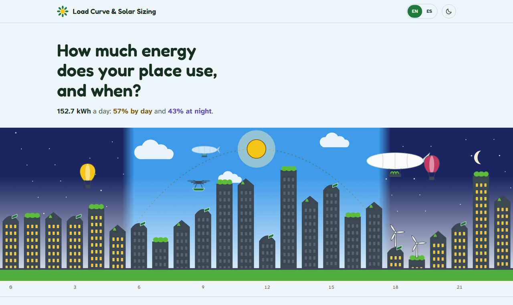
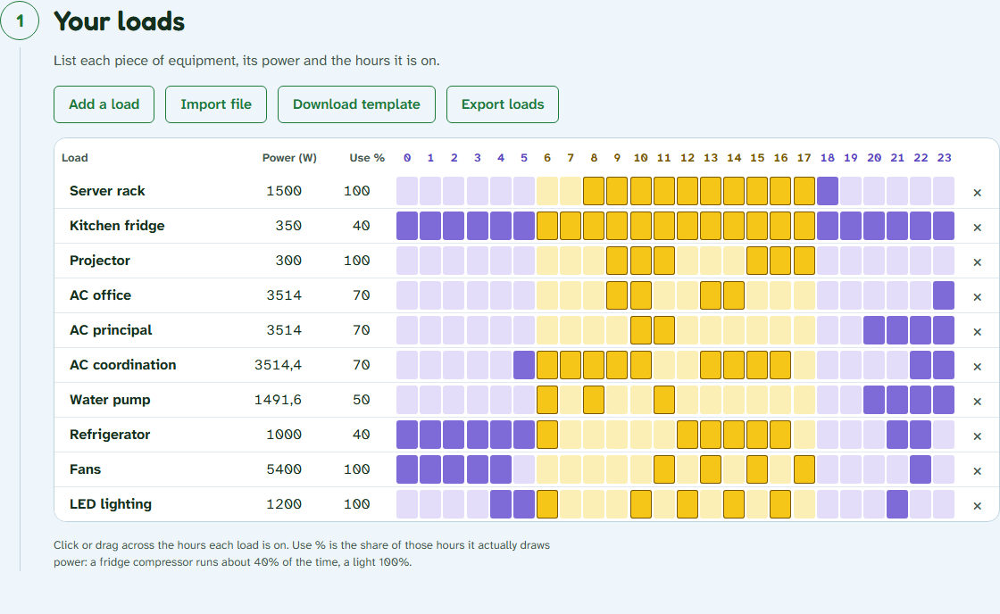
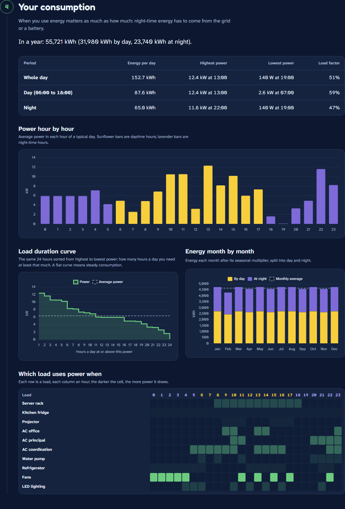
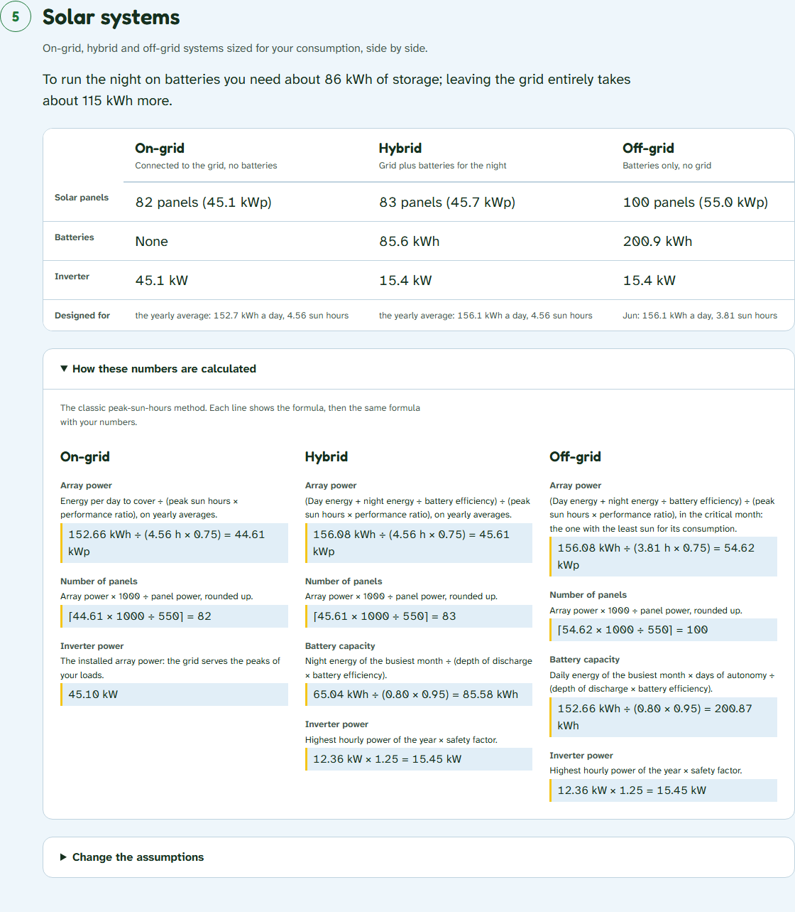
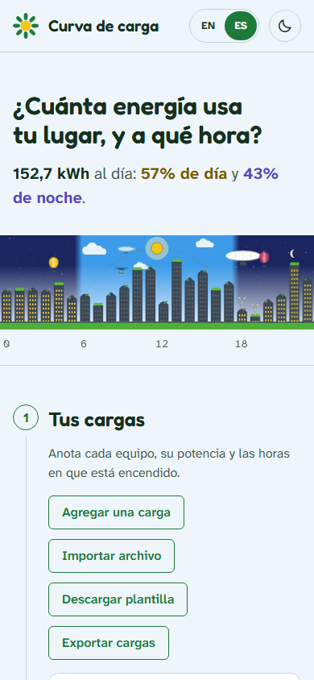

# Load Curve & Solar Sizing

Estimate how much electricity a home, business or building uses **hour by hour**, and compare the on-grid, hybrid and off-grid solar systems that could supply it.



The question behind it: *when* you use energy matters as much as *how much*. Daytime consumption can come straight from the panels; night-time consumption needs the grid or batteries. Seeing the day/night split and what each system would take helps decide whether batteries are worth it.

It is a full rewrite of my earlier Streamlit prototype, [Herramienta-Cuadro-de-Carga](https://github.com/rjrnova18-debug/Herramienta-Cuadro-de-Carga): a tested calculation engine, a FastAPI backend and a hand-built frontend.

## Features

- **Load table editor**: each piece of equipment with its rated power, a usage factor (a fridge compressor runs about 40% of each hour) and the hours it is on, painted by dragging across a 24-hour grid. Import and export CSV or Excel, including the old Spanish template; invalid rows are listed with their row and column instead of failing the whole file.
- **Consumption analysis**: hourly profile, load duration curve, peak/base power and load factor for the whole day, daytime and night-time, monthly and yearly energy with seasonal multipliers, and a load × hour heatmap.
- **Solar resource**: the twelve monthly peak sun hours of any location from [PVGIS](https://joint-research-centre.ec.europa.eu/photovoltaic-geographical-information-system-pvgis_en) (EU Joint Research Centre), with the optimal panel tilt, or typed by hand.
- **System sizing**: on-grid, hybrid and off-grid systems side by side (panels, battery capacity, inverter), with **every formula shown with your own numbers** and editable assumptions.
- **Your work stays yours**: save the whole study as a JSON file and open it later, download an Excel report, or print a clean A4 report. Nothing is stored on the server.
- **English and Spanish**, light and dark themes, keyboard friendly, colour-blind-safe day/night colours, and reduced motion respected.

| Load table | Consumption (dark theme) |
|---|---|
|  |  |

| System comparison with formulas | Mobile, in Spanish |
|---|---|
|  |  |

## How the sizing works

The classic peak-sun-hours method, refined where the simple version gives wrong answers:

| | On-grid | Hybrid | Off-grid |
|---|---|---|---|
| **Array (kWp)** | energy to cover ÷ (sun hours × performance ratio), yearly averages | (day energy + night energy ÷ battery efficiency) ÷ (sun hours × PR), yearly averages | same, in the **critical month**: the least sun for its consumption |
| **Batteries (kWh)** | none | night energy of the busiest month ÷ (depth of discharge × efficiency) | daily energy × days of autonomy ÷ (DoD × efficiency) |
| **Inverter (kW)** | the installed array (the grid serves load peaks) | highest hourly power × safety factor | highest hourly power × safety factor |

Months without sun (polar winters) make an off-grid system impossible; the app says so instead of returning an infinite array.

## Run locally

Requires Python 3.12.

```bash
python -m venv venv
source venv/Scripts/activate      # Windows (Git Bash); on macOS/Linux: source venv/bin/activate
pip install -e ".[dev]"

python -m loadcurve
```

Open <http://127.0.0.1:8000> for the app and <http://127.0.0.1:8000/docs> for the interactive API docs.

## Development

```bash
pytest                              # backend tests
node --test "tests/web/*.test.mjs"  # frontend module tests (Node 22+)
ruff check . && ruff format .       # lint and format
```

GitHub Actions runs all of them on every push.

## Project structure

```
src/loadcurve/
├── domain/      pure calculations (no I/O): models, analysis, sizing, study
├── files/       CSV/XLSX import and export, Excel report (pandas)
├── solar/       PVGIS adapter (HTTP client injected, mocked in tests)
├── api/         FastAPI app and routes
└── web/         frontend: HTML, CSS, JavaScript modules, i18n, vendored Chart.js
    └── js/
        ├── state.js, api.js, i18n.js, format.js, errors.js, studyFile.js
        └── views/   hero, load table, settings, location, results, systems, study actions
tests/           pytest and node tests, mirroring src/
```

## API

| Method | Path | Description |
|---|---|---|
| `POST` | `/api/analysis` | Analyse a study; sizes the three system types when it has a solar resource |
| `GET` | `/api/solar-resource?lat=&lon=` | Monthly peak sun hours and optimal panel orientation from PVGIS |
| `POST` | `/api/load-table/import` | Read a CSV/XLSX load table; invalid rows are reported, not fatal |
| `POST` | `/api/load-table/export?format=csv\|xlsx` | Download a load table |
| `GET` | `/api/load-table/template?format=csv\|xlsx` | Download the sample load table |
| `POST` | `/api/report` | Download the study and its results as an Excel workbook |
| `GET` | `/api/health` | Health check |

Errors carry stable codes that the frontend translates: validation errors use FastAPI's `422` body (`detail[].type`), everything else returns `{"detail": {"code": "..."}}` (for example `location_over_sea` or `missing_columns`).

## Design notes

- **Stateless**: no database or accounts. The browser holds the study; files keep it.
- **One place for each rule**: the domain types are Pydantic models, so the same validation applies to JSON requests and to spreadsheet rows.
- **No frontend build**: plain JavaScript modules and one vendored library (Chart.js, checked against its npm integrity hash). A single store and a `render(state)` per view replace a framework.

## What I learned

- **Separating the calculation engine from everything else.** The prototype mixed UI and maths in one 1,250-line script. Pulling the maths into pure functions made its bugs testable: the night-time peak used `idxmin()` instead of `idxmax()` (reporting 19:00 instead of 22:00 on the sample data), and equal day start and end hours silently produced a day with no night. Both now have regression tests.
- **Modelling the domain before coding it.** Naming things precisely (load, usage factor, daytime window, critical month) exposed decisions the prototype never made, such as how a fridge that cycles on and off should count.
- **Validation that serves the user.** Pydantic error types become codes, codes become messages in two languages, and a spreadsheet with two bad rows still imports the good ones.
- **Real-world spreadsheets with pandas**: `;` separators, decimal commas, Windows encodings, numeric headers and blank cells.
- **Wrapping an external API behind an adapter**, injecting the HTTP client and testing timeouts, sea locations and broken answers without touching the network.
- **Floating-point ties**: twelve identical months differed by about 1e-15, enough to make April "more critical" than January. Comparing rounded values fixed it.
- **A frontend without a framework**: one source of truth and render functions, accessible colour contrast (WCAG AA, checked with a script), reduced motion, keyboard use, and fixing layout bugs found by automated screenshots.

## Possible improvements

- Economics: equipment cost, tariff, savings and payback per system.
- Motor start-up surges (pumps, compressors) for inverter sizing.
- Hourly solar data (PVGIS typical meteorological year) instead of monthly averages, to simulate battery charge hour by hour.
- Panel tilt and orientation chosen by the user instead of PVGIS's optimum.
- A public live demo.

## Credits

- Solar data: [PVGIS](https://joint-research-centre.ec.europa.eu/photovoltaic-geographical-information-system-pvgis_en), European Commission Joint Research Centre.
- Charts: [Chart.js](https://www.chartjs.org/) (MIT).
- Fonts: [Fredoka](https://fonts.google.com/specimen/Fredoka) and [Atkinson Hyperlegible Next](https://fonts.google.com/specimen/Atkinson+Hyperlegible+Next) (SIL Open Font License).
